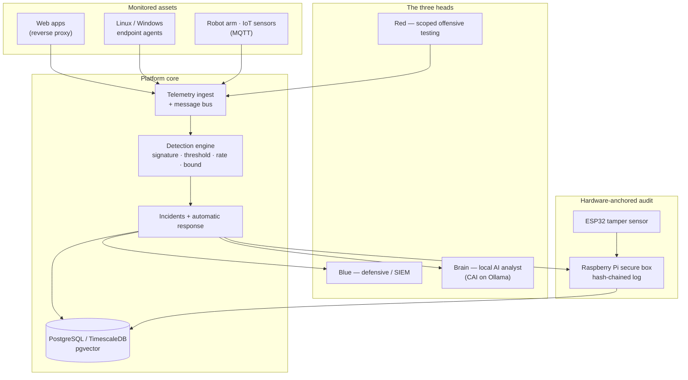
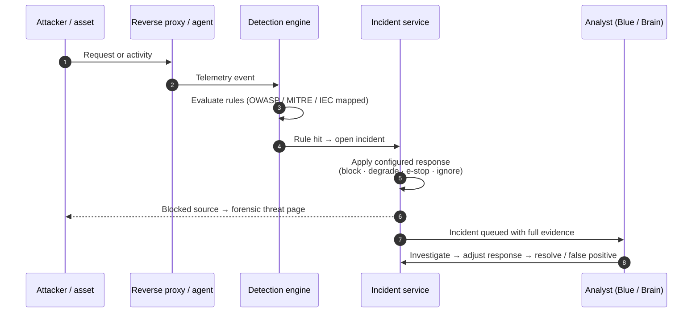

# Cyber Incident Analysis and Response Platform

A self-hosted SOC platform that unifies defensive detection, controlled offensive testing,
and a local AI analyst over a single telemetry pipeline — with a hardware-anchored,
tamper-evident audit trail.

Built as a Master's dissertation project. Detection maps every finding to OWASP, MITRE
ATT&CK (Enterprise and ICS) and IEC 62443, so each alert carries the framework context an
analyst needs to triage it.

  
  
  
  
  

> [!IMPORTANT]
> **This is a DEMO / showcase repository.**
> It presents the project through documentation, architecture diagrams and screenshots.
> The full source code lives in a private repository while the dissertation is in progress.
> Nothing here is runnable, and no exploit code, payloads or credentials are published.

---

## The problem

A small security team watching OT/IoT and web assets at once faces three gaps at the same
time: alerts arrive without framework context, response is manual and slow, and the audit
trail of "who decided what, when" lives in logs that an attacker with host access can edit.

This platform addresses all three in one pipeline — detection with built-in framework
mapping, configurable automatic response with a human-review workflow, and an audit log
anchored in hardware so its integrity does not depend on the host it protects.

## Architecture

Three cooperating "heads" share one telemetry and incident backbone, plus a hardware audit
module that signs the record of every decision.

- **Blue** turns telemetry into incidents and drives containment.
- **Red** runs vulnerability scanning and controlled testing, confined to a scope allowlist
  enforced in code and gated behind explicit human approval — lab use only.
- **Brain** is a local AI security agent (CAI, served by Ollama) that assists triage without
  sending any data to a third party.
- **Audit** writes every response decision to a hash-chained log on a Raspberry Pi, with an
  ESP32 reporting physical tamper events, so the record stays trustworthy even if a
  monitored host is compromised.

## From signal to contained incident

Detection, automatic response and the analyst's review are one continuous flow. A blocked
source is served a forensic "under investigation" page instead of a bare `403`.

## Detection coverage

The threat catalog is intentionally complete across system profiles, so the coverage view
shows the whole landscape — detected threats and current gaps alike, rather than hiding what
is not yet covered.

| Profile | Example threats | Frameworks |
|---|---|---|
| Web | SQLi, XSS, SSRF, path traversal, SSTI, deserialization, Log4Shell-class | OWASP Top 10, CWE, CAPEC |
| Network | Port scan, L7 flood, (planned) volumetric / DNS tunnelling / C2 | MITRE ATT&CK |
| Linux host | SSH brute force, suspicious process, credential access, privilege escalation | MITRE ATT&CK |
| Windows host | Logon brute force, encoded PowerShell, audit-log clearing | ATT&CK + Event IDs |
| Robot (OT) | Unauthorized command, torque / speed over limit, mode change, collision | ATT&CK ICS, IEC 62443, ISO 10218 |
| IoT | Physical intrusion, sensor spoofing, overheating | OWASP IoT Top 10 |

Rules are deterministic and evaluated over sliding windows: **signature**, **threshold**,
**rate**, and **field-bound** (safety limits). Each incident records the response taken, so
the analyst reviews a decision rather than a raw alert.

## Automatic response and investigation

Each rule carries a configurable response — `none`, `ignore`, `mark_degraded`,
`block_source`, or `robot_estop`. When an incident opens, the platform takes that action
automatically and records it. An analyst then **starts investigating**, can **change the
response**, and **resolves** or marks the incident a **false positive** (which lifts any
block). A blocked source is redirected to a step-by-step forensic page that replays the
request and shows the attacker's fingerprint — not a generic error.

## Screenshots

> Screenshots are added as each view is finalized. Drop images into `docs/images/` and
> they appear here.

<!--

-->

| View | What it shows |
|---|---|
| Operations dashboard | Live incident and telemetry overview |
| Incident investigation | Full attacker profile, evidence, response workflow |
| Detection coverage | Threat catalog mapped to frameworks, with gaps surfaced |
| Forensic threat page | The "under investigation" page served to a blocked source |
| Grafana observability | Telemetry time-series and platform health |

## Technology

| Layer | Stack |
|---|---|
| Backend | Python 3.12, FastAPI, SQLAlchemy 2 (async), Alembic, Pydantic v2 |
| Data | PostgreSQL 16 with TimescaleDB and pgvector |
| Messaging | RabbitMQ (events), Redis + Celery (tasks), MQTT (OT/IoT telemetry) |
| Frontend | React 18, TypeScript, Vite, TailwindCSS, TanStack Query |
| Endpoint agent | Python, httpx, psutil — Linux, Windows-sim and web-log profiles |
| AI | CAI security agent served locally via Ollama |
| Hardware | Raspberry Pi (hash-chained audit box), ESP32 (tamper sensor) |
| Delivery | Docker Compose, nginx reverse proxy, isolated lab network |

## Scope and ethics

This is a defensive platform demonstrated in an isolated lab. The offensive capabilities are
constrained by design: every action is checked against a scope allowlist enforced in code,
exploitation requires an explicit human-approval flag, and the lab network has no route to
the internet or the host. This repository contains no exploit code, payloads or
vulnerability-trigger logic.

## Status

Active development as part of an ongoing Master's dissertation. The defensive detection and
response pipeline, endpoint agents, incident workflow and lab are implemented; observability
dashboards and the ML-assisted detection layer are in progress.

## Attribution

Master's dissertation project developed by a small team. This repository is a personal
showcase of the work and its architecture.

## License

Documentation and diagrams in this repository are released under the [MIT License](LICENSE).
